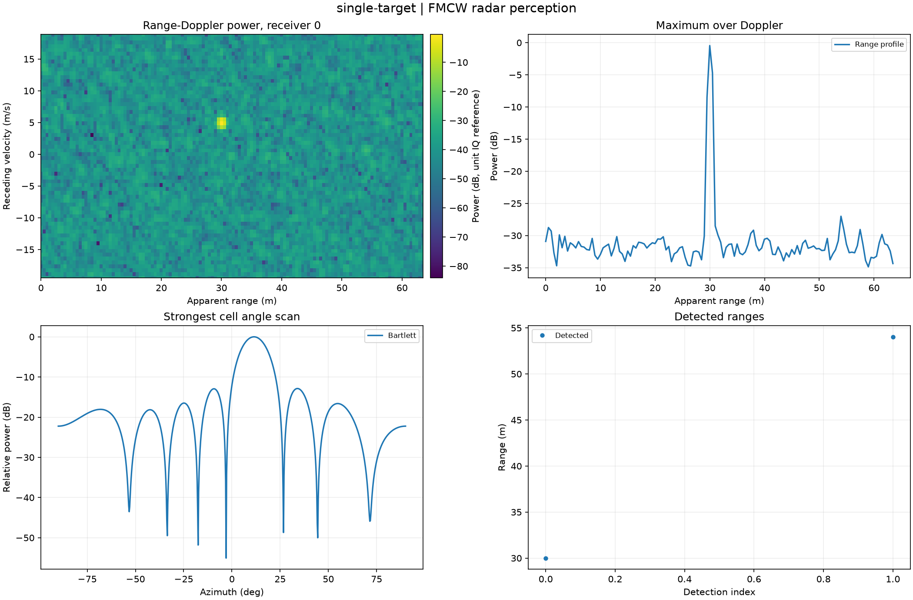
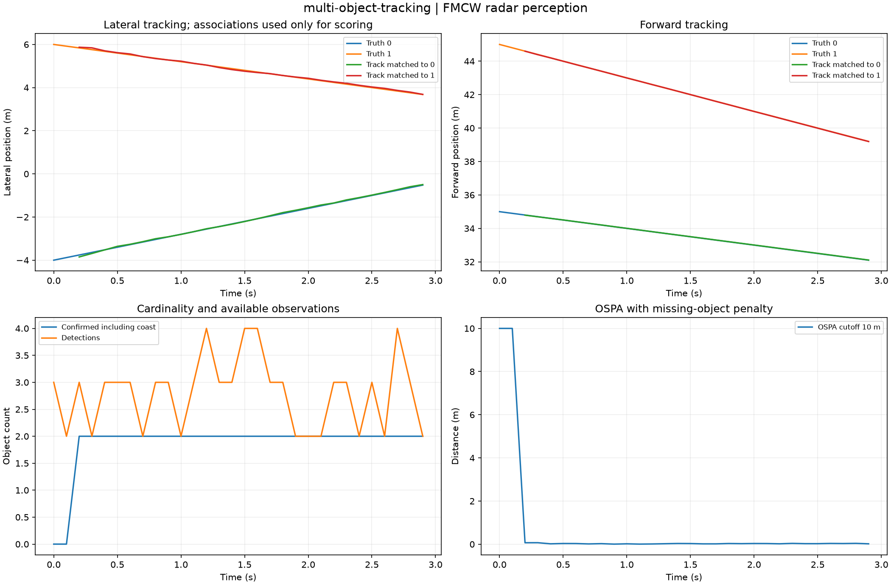
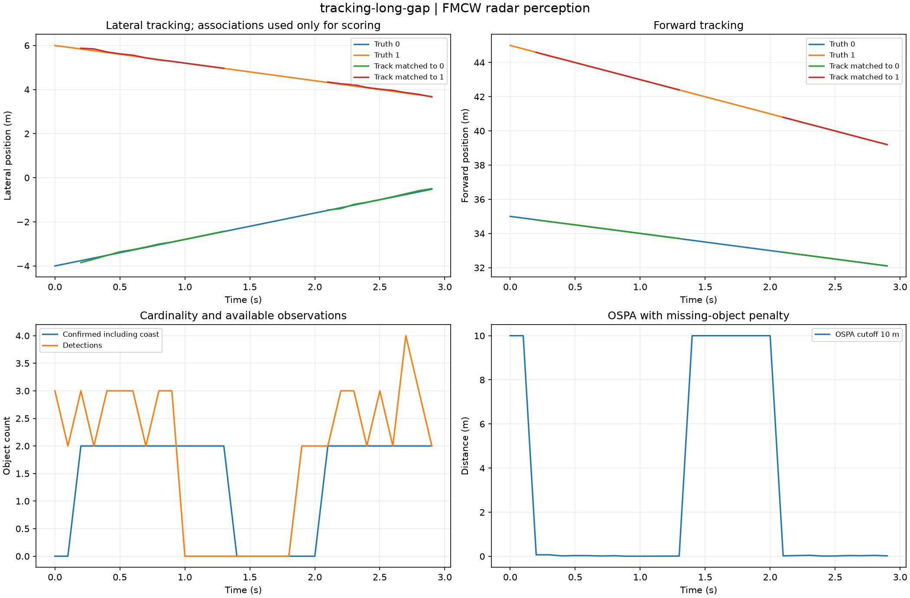
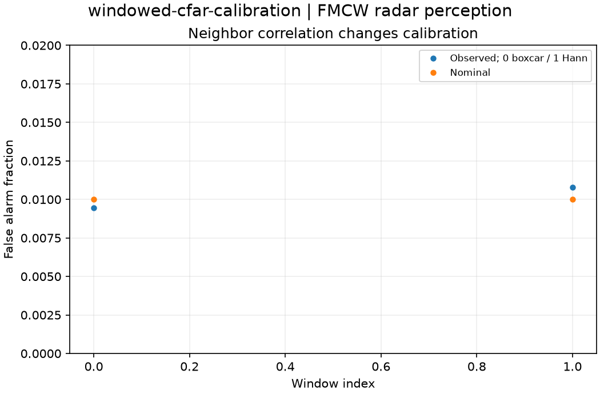
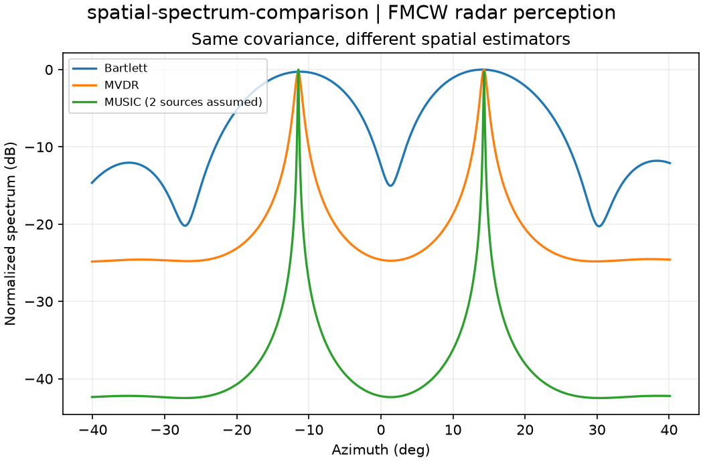

# Computed experiment gallery

Twenty-four default studies computed from clean source revision [`df371aecc0a1`](https://github.com/VictorOdoyo/radar-perception-stack/commit/df371aecc0a1f6b651ef08fc93e7ab3fd8cf11da).
All values below come from the sealed captures. Each case directory contains the complete
NPZ arrays, CSV tables, parameters, provenance, plot and HTML report.

HTML files can be opened locally; GitHub previews the figures and tables directly.

| Study | Selected measured outputs | Artifacts |
| --- | --- | --- |
| [single-target](gallery/single-target/figure.png) | clipped_fraction = 0; detections = 2 | [summary](gallery/single-target/summary.csv), [setup](gallery/single-target/parameters.json), [archive](gallery/single-target/fields.npz), [report](gallery/single-target/index.html) |
| [two-targets](gallery/two-targets/figure.png) | clipped_fraction = 0; detections = 3 | [summary](gallery/two-targets/summary.csv), [setup](gallery/two-targets/parameters.json), [archive](gallery/two-targets/fields.npz), [report](gallery/two-targets/index.html) |
| [unresolved-targets](gallery/unresolved-targets/figure.png) | clipped_fraction = 0; detections = 2 | [summary](gallery/unresolved-targets/summary.csv), [setup](gallery/unresolved-targets/parameters.json), [archive](gallery/unresolved-targets/fields.npz), [report](gallery/unresolved-targets/index.html) |
| [clutter-contamination](gallery/clutter-contamination/figure.png) | clipped_fraction = 0; detections = 20 | [summary](gallery/clutter-contamination/summary.csv), [setup](gallery/clutter-contamination/parameters.json), [archive](gallery/clutter-contamination/fields.npz), [report](gallery/clutter-contamination/index.html) |
| [clutter-subtraction](gallery/clutter-subtraction/figure.png) | clipped_fraction = 0; detections = 14 | [summary](gallery/clutter-subtraction/summary.csv), [setup](gallery/clutter-subtraction/parameters.json), [archive](gallery/clutter-subtraction/fields.npz), [report](gallery/clutter-subtraction/index.html) |
| [multipath-ghosts](gallery/multipath-ghosts/figure.png) | clipped_fraction = 0; detections = 3 | [summary](gallery/multipath-ghosts/summary.csv), [setup](gallery/multipath-ghosts/parameters.json), [archive](gallery/multipath-ghosts/fields.npz), [report](gallery/multipath-ghosts/index.html) |
| [adc-saturation](gallery/adc-saturation/figure.png) | clipped_fraction = 0.958595; detections = 3 | [summary](gallery/adc-saturation/summary.csv), [setup](gallery/adc-saturation/parameters.json), [archive](gallery/adc-saturation/fields.npz), [report](gallery/adc-saturation/index.html) |
| [receiver-calibration-error](gallery/receiver-calibration-error/figure.png) | clipped_fraction = 0; detections = 2 | [summary](gallery/receiver-calibration-error/summary.csv), [setup](gallery/receiver-calibration-error/parameters.json), [archive](gallery/receiver-calibration-error/fields.npz), [report](gallery/receiver-calibration-error/index.html) |
| [oscillator-phase-noise](gallery/oscillator-phase-noise/figure.png) | clipped_fraction = 0; detections = 7 | [summary](gallery/oscillator-phase-noise/summary.csv), [setup](gallery/oscillator-phase-noise/parameters.json), [archive](gallery/oscillator-phase-noise/fields.npz), [report](gallery/oscillator-phase-noise/index.html) |
| [chirp-nonlinearity](gallery/chirp-nonlinearity/figure.png) | clipped_fraction = 0; detections = 2 | [summary](gallery/chirp-nonlinearity/summary.csv), [setup](gallery/chirp-nonlinearity/parameters.json), [archive](gallery/chirp-nonlinearity/fields.npz), [report](gallery/chirp-nonlinearity/index.html) |
| [low-snr-detection](gallery/low-snr-detection/figure.png) | clipped_fraction = 0; detections = 1 | [summary](gallery/low-snr-detection/summary.csv), [setup](gallery/low-snr-detection/parameters.json), [archive](gallery/low-snr-detection/fields.npz), [report](gallery/low-snr-detection/index.html) |
| [chirp-dropout](gallery/chirp-dropout/figure.png) | clipped_fraction = 0; detections = 7 | [summary](gallery/chirp-dropout/summary.csv), [setup](gallery/chirp-dropout/parameters.json), [archive](gallery/chirp-dropout/fields.npz), [report](gallery/chirp-dropout/index.html) |
| [multi-object-tracking](gallery/multi-object-tracking/figure.png) | final_confirmed_tracks = 2; final_ospa_m = 0.0184719 | [summary](gallery/multi-object-tracking/summary.csv), [setup](gallery/multi-object-tracking/parameters.json), [archive](gallery/multi-object-tracking/fields.npz), [report](gallery/multi-object-tracking/index.html) |
| [tracking-short-gap](gallery/tracking-short-gap/figure.png) | final_confirmed_tracks = 2; final_ospa_m = 0.0188588 | [summary](gallery/tracking-short-gap/summary.csv), [setup](gallery/tracking-short-gap/parameters.json), [archive](gallery/tracking-short-gap/fields.npz), [report](gallery/tracking-short-gap/index.html) |
| [tracking-long-gap](gallery/tracking-long-gap/figure.png) | final_confirmed_tracks = 2; final_ospa_m = 0.0205287 | [summary](gallery/tracking-long-gap/summary.csv), [setup](gallery/tracking-long-gap/parameters.json), [archive](gallery/tracking-long-gap/fields.npz), [report](gallery/tracking-long-gap/index.html) |
| [maneuver-model-mismatch](gallery/maneuver-model-mismatch/figure.png) | final_confirmed_tracks = 2; final_ospa_m = 0.106129 | [summary](gallery/maneuver-model-mismatch/summary.csv), [setup](gallery/maneuver-model-mismatch/parameters.json), [archive](gallery/maneuver-model-mismatch/fields.npz), [report](gallery/maneuver-model-mismatch/index.html) |
| [cfar-false-alarm](gallery/cfar-false-alarm/figure.png) | maximum_absolute_error = 0.00214946 | [summary](gallery/cfar-false-alarm/summary.csv), [setup](gallery/cfar-false-alarm/parameters.json), [archive](gallery/cfar-false-alarm/fields.npz), [report](gallery/cfar-false-alarm/index.html) |
| [windowed-cfar-calibration](gallery/windowed-cfar-calibration/figure.png) | boxcar_rate = 0.00945561; hann_rate = 0.0107887 | [summary](gallery/windowed-cfar-calibration/summary.csv), [setup](gallery/windowed-cfar-calibration/parameters.json), [archive](gallery/windowed-cfar-calibration/fields.npz), [report](gallery/windowed-cfar-calibration/index.html) |
| [os-cfar-contamination](gallery/os-cfar-contamination/figure.png) | final_ca_pd = 0; final_os_pd = 0.6394 | [summary](gallery/os-cfar-contamination/summary.csv), [setup](gallery/os-cfar-contamination/parameters.json), [archive](gallery/os-cfar-contamination/fields.npz), [report](gallery/os-cfar-contamination/index.html) |
| [spatial-spectrum-comparison](gallery/spatial-spectrum-comparison/figure.png) | covariance_condition = 411.364 | [summary](gallery/spatial-spectrum-comparison/summary.csv), [setup](gallery/spatial-spectrum-comparison/parameters.json), [archive](gallery/spatial-spectrum-comparison/fields.npz), [report](gallery/spatial-spectrum-comparison/index.html) |
| [ego-motion-consensus](gallery/ego-motion-consensus/figure.png) | least_squares_error_m_s = 1.12122; robust_error_m_s = 0.00235516 | [summary](gallery/ego-motion-consensus/summary.csv), [setup](gallery/ego-motion-consensus/parameters.json), [archive](gallery/ego-motion-consensus/fields.npz), [report](gallery/ego-motion-consensus/index.html) |
| [dual-prf-unwrapping](gallery/dual-prf-unwrapping/figure.png) | maximum_error_m_s = 0 | [summary](gallery/dual-prf-unwrapping/summary.csv), [setup](gallery/dual-prf-unwrapping/parameters.json), [archive](gallery/dual-prf-unwrapping/fields.npz), [report](gallery/dual-prf-unwrapping/index.html) |
| [chirp-ambiguity](gallery/chirp-ambiguity/figure.png) | zero_offset_magnitude = 1 | [summary](gallery/chirp-ambiguity/summary.csv), [setup](gallery/chirp-ambiguity/parameters.json), [archive](gallery/chirp-ambiguity/fields.npz), [report](gallery/chirp-ambiguity/index.html) |
| [receiver-calibration-recovery](gallery/receiver-calibration-recovery/figure.png) | maximum_calibrated_error_deg = 7.10543e-15; maximum_uncalibrated_error_deg = 1.91635 | [summary](gallery/receiver-calibration-recovery/summary.csv), [setup](gallery/receiver-calibration-recovery/parameters.json), [archive](gallery/receiver-calibration-recovery/fields.npz), [report](gallery/receiver-calibration-recovery/index.html) |

## Selected fields and diagnostics

### single-target

### multi-object-tracking

### tracking-long-gap

### windowed-cfar-calibration

### spatial-spectrum-comparison

## Interpretation

These are synthetic radar studies. Truth is used for signal synthesis and post-solve scoring, while the tracker receives detections only. Unresolved targets, specular ghosts, clipping and long observation gaps deliberately retain failures. Hann windows correlate spectral cells; nominal CFAR probabilities are not universal calibration guarantees.

Reproduce with `radarlab batch --data-only --output outputs/catalog`, then `radarlab render outputs/catalog` and `radarlab verify outputs/catalog`. Replay retains original source provenance.
